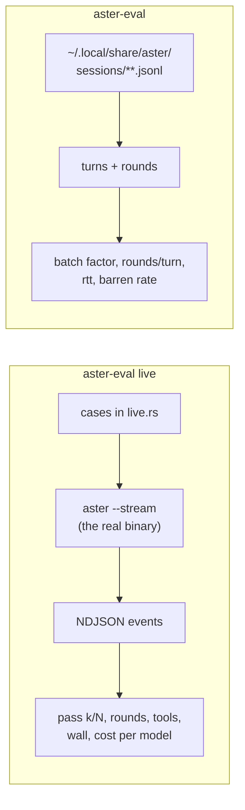

# Evaluation

Aster measures itself two ways, and they answer different questions. **Live
evals** fix the task and vary the model, so a change can be shown to help.
**Session grading** takes ordinary recorded use and asks what it cost. Neither
one subsumes the other: the live suite cannot tell you how Aster behaves on your
actual work, and session grading cannot tell you whether yesterday's commit
helped, because every session ran a different task.

The crate is [aster-eval](../crates/aster-eval). Its output is what
[HARNESS-FINDINGS.md](HARNESS-FINDINGS.md) is written from. The live half
spawns the real `aster` binary for each case and judges it from the NDJSON
that `--stream` emits, so there is no runner between the cases and the
shipped harness.



## What a round is, and why it is the metric

A **turn** is everything between one user message and the next. A **round** is
one assistant message that carried at least one tool call, which is exactly one
model round-trip. A round costs a full network round-trip whether it carries one
tool call or seven, so the ratio between them is the lever:

- **Batch factor** = tool calls ÷ rounds. 1.00 means the model never groups
calls and every call cost its own round-trip.
- **Single-call rate** = share of rounds carrying exactly one call. The same
fact from the other side, and the easier one to reason about.
- **Barren rate** = share of tool results that told the model nothing (empty, or
a known no-information reply like `no files matched`). A barren result means
the round that produced it was spent for nothing.

Outcome-only evals are blind to all three. A harness can answer correctly and
still take nineteen round-trips to do it, and the user feels the nineteen.

## Session grading

```
cargo run -p aster-eval
```

Reads every `*.jsonl` under `~/.local/share/aster/sessions` recursively,
rebuilds turns and rounds from the flat transcript, and prints one report.

```
aster-eval [SESSIONS_DIR] [options]

  --since DAYS       only sessions created in the last DAYS days
  --model NAME       only sessions recorded against this model
  --json             machine-readable, for diffing snapshots
  --baseline FILE    compare against an earlier --json report
```

The default directory is `aster_persist::default_home()/sessions`, which is
`~/.local/share/aster/sessions` unless `XDG_DATA_HOME` is set. Note that
`~/.aster` is the *config* root (`aster.yaml`, `.env`, `mcp.json`) and holds
migrated leftovers; it is not where sessions are read from.

### Reading the report

The tool table is where fixes come from. `calls` is volume, `barren` is how
often the tool answered nothing, and the duration columns are per call:

```
tool             calls  barren     p50     p90    total
search_files       242   15.3%   0.03s   0.06s    16.2s
find_files          39   43.6%   0.01s   1.53s    36.8s
```

A high barren rate on a low-volume tool is still worth fixing, because each
barren result usually buys a retry, and each retry is another round.

The model table splits batching by model, which is how you notice that the
model configured for review is the worst batcher in the corpus.

### Comparing two snapshots

```bash
cargo run -p aster-eval -- --json > before.json
# ... change something, use Aster for a while ...
cargo run -p aster-eval -- --baseline before.json
```

`Report::compare` reports six deltas: batch factor, single-call rounds, barren
results, rounds/turn p50, model rtt p50, and active turn p90. Each carries its
own `higher_is_better` flag, so a delta is judged by direction rather than by
magnitude, and a metric that did not move is reported as neither.

One caveat specific to this mode: running Aster to produce the "after" sessions
writes into the same directory the grader reads, so the corpus grows while you
measure it. Freeze a `--json` snapshot before analysing.

## Running the live evals

```bash
cargo run -p aster-eval -- live --models glm-5p3-flash,deepseek-flash --runs 3
```

```
aster-eval live [options]

  --models a,b   models to compare (default: the configured one)
  --runs N       run every case N times and report medians (default: 1)
  --bin PATH     aster binary to measure (default: `aster` on PATH)
  --repo DIR     checkout aster runs against (default: the enclosing git repo)
```

Each case runs `aster --stream --permission-mode auto [--model M] <prompt>` in
the repo, with a 10 minute ceiling. Pass `--bin target/debug/aster` to measure
a build that is not installed yet. Credentials and the model catalogue come
from the normal aster config, so whatever `aster` can reach, the eval can.
Every case costs real tokens: start with `--runs 1` on one model and read the
cost column before sweeping.

The report prints one line per case, `pass k/N` with the median wall time and
median rounds, then each failing run's reasons in plain words, then a table
per model. It exits non-zero if any run failed.

### How a run is judged

The runner reads these events and ignores the rest:

| Event               | Used for                                   |
| ------------------- | ------------------------------------------ |
| `token` / `text`    | the answer text that `must_mention` checks |
| `tool_call`         | the tool list and the round count          |
| `tool_result`       | closing the current round                  |
| `done`              | the final reply and `estimated_cost_usd`   |
| `error`             | the failure reason                         |

aster emits every `tool_call` of a round before any of its results, so a call
that follows a result opens a new round. That is how the live suite measures
batching directly. A run that exits without `done` or `error` fails with the
last line aster wrote to stderr.

### Adding a case

Cases live in `default_cases()` in [live.rs](../crates/aster-eval/src/live.rs).

```rust
Case {
    name: "does not re-run an identical search".into(),
    prompt: "Which function in crates/aster-tools decides whether a directory \
             is skipped? Name it and the file it lives in.".into(),
    must_mention: Some("is_skipped".into()),
    calls: vec!["search_files".into()],      // tools that must run
    avoids: vec!["edit_file".into()],        // tools that must never run
    at_most: vec![("search_files".into(), 3)], // per-tool ceilings
    max_rounds: None,                        // ceiling on model round-trips
}
```

Each case encodes a harness fix, so a regression in that fix fails an eval
instead of going unnoticed until the next findings pass. The ceilings are the
part that catches waste: a regression usually shows up as the answer staying
correct while the call count climbs. `max_rounds` is the ceiling that does not
care which tool the model picked.

## Terminal-Bench

The live suite checks Aster against its own regressions. For a number other
people recognise, Aster runs [Terminal-Bench](https://www.tbench.ai) through
[Harbor](https://harborframework.com), its official runner. Each task is a
container with an instruction and a hidden verifier; the score is the share of
tasks the verifier passes.

[aster_agent.py](../crates/aster-eval/harbor/aster_agent.py) is the Harbor
agent. It installs the static musl release of `aster` into each task container
and runs `aster --stream --permission-mode yolo` on the instruction; the
container is the isolation. Model and credentials come in as `ASTER_*`
variables:

```bash
harbor datasets download terminal-bench/terminal-bench@4.0.0 -o tb
PYTHONPATH=crates/aster-eval/harbor harbor run \
  -p tb/terminal-bench/<task> -a aster_agent:Aster -n 1 \
  --agent-timeout-multiplier 0.0625 \
  --ae ASTER_BASE_URL=https://api.fireworks.ai/inference/v1 \
  --ae ASTER_MODEL=accounts/fireworks/models/glm-5p3-flash \
  --ae ASTER_API_KEY=$FIREWORKS_API_KEY \
  --ae ASTER_MAX_TOOL_ROUNDS=60
```

Use `-d terminal-bench/terminal-bench@4.0.0` instead of `-p` for the full
set. Pin a release with `--ak version=0.7.1`; the default is the latest. To
measure unreleased changes, build a static binary for the task images
(amd64) and pass it with `--ak binary=PATH`:

```bash
cargo zigbuild --release --locked -p aster-cli --bin aster \
  --target x86_64-unknown-linux-musl
```

Terminal-Bench 4.0 tasks are expert work: the agent limit is eight hours and
the expert estimate several hours each. Cap every run with
`--agent-timeout-multiplier` and `ASTER_MAX_TOOL_ROUNDS`, and run a couple of
tasks before the full set. A score taken under those caps is not comparable
with a leaderboard entry run at the default limits; say which caps were used
whenever a number is quoted.

## Known limits of the instruments

These bound what the numbers above can claim. State them alongside any result
taken from this crate.

**A ceiling on an uncalled tool passes vacuously.** `at_most` counts one named
tool. When the model reaches the answer with a different tool the count is zero
and the assertion passes without constraining anything. A case capping
`find_files` at five passes on a run that only called `search_files`. Prefer a
ceiling on the tool the case is actually about, and pair it with `calls` so the
tool must run at all.

**Rounds are inferred from event order.** The stream carries no round id; the
runner relies on aster emitting a round's calls before its results. Calls
that aster handles internally (skill reads) are not emitted and do not count.

**Single runs are noise.** The same case on the same model has produced
`explore×1` on one run and `find_files×2 read_file×2` on the next; earlier
measurements varied 1, 1, 3, 2 on one case. Use `--runs` and compare medians
before believing a difference between models or builds.

**A batched round charges every call the slowest one's wall time.**
[turn.rs](../crates/aster-eval/src/turn.rs) measures from the assistant
message that issued a call to the tool message that returned it, and every
result in a round shares one recorded timestamp. One two-call round recorded
`list_files` and `aster_mcp` at 72.98s each, identical to the hundredth. Per-tool
duration is only trustworthy for tools that predominantly appear alone. Call
counts, barren rates, round counts, and the batch factor do not depend on
duration and are unaffected. Fixing this needs per-call timestamps in the
transcript, which the format does not carry yet.

**Cost is a token proxy, not money.** `UsageSnapshot` prices prompt and
completion tokens at one global rate pair (`ASTER_PRICE_PROMPT_PER_M`,
`ASTER_PRICE_COMPLETION_PER_M`, defaulting to 0.15/0.60), with no per-model
table and no discount for cached input. In a `--models` sweep every model is
priced identically, so the cost column ranks by token volume alone. The
"fewest rounds" recommendation is unaffected because it ranks on rounds and
calls.
`Usage` also parses only `prompt_tokens` and `completion_tokens`, so
provider-side cache hits are invisible.

**A session corpus is not a controlled workload.** Sessions accumulate from real
use across different repos and tasks, so per-model splits are confounded with
the task mix each model happened to receive. Aggregates over the whole corpus
are the robust part. A causal per-model claim needs the same task set across
models, which is the live suite's job.

## Where the numbers go

Findings from a grading pass land in
[HARNESS-FINDINGS.md](HARNESS-FINDINGS.md) with their evidence and the shape of
a fix. When a fix ships, it moves to the changelog and, where a live eval can
hold the line, becomes a case in `default_cases()`.

One axis this crate still does not cover: scoring recall and precision against
planted defects for review and fix runs, storing results keyed by config hash,
and sweeping one configuration axis at a time.